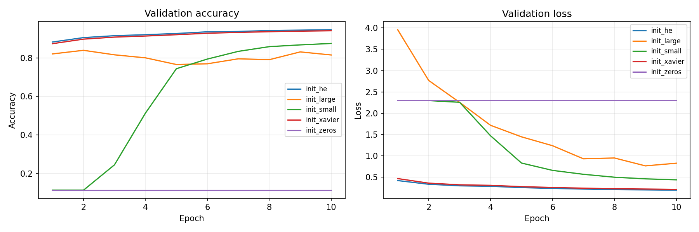
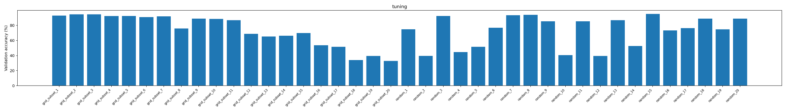
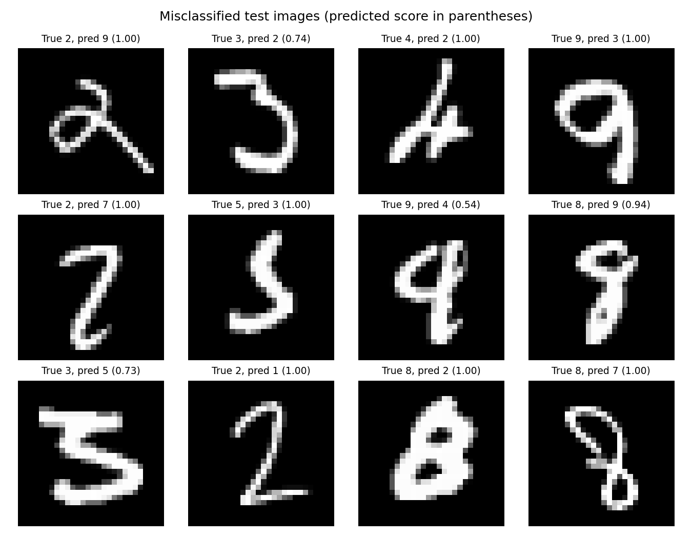

# MNIST Neural Network Ablation Studies (NumPy)

**Reproducible experiments on fully connected neural networks built from scratch in NumPy.**  
*Course project: Ablation Studies & Experiments for NumPy MNIST Neural Network.*

This repository documents the 14 required experimental tasks spanning activation functions, architecture, optimization, initialization, generalization, loss functions, preprocessing, hyperparameter search, debugging, and error analysis. The implementations perform forward propagation, backpropagation, and parameter updates in NumPy without relying on a deep-learning framework. Optional advanced experiments are also supported in the extended runner.

## At a glance

| Highlight | Observed outcome | Experiment |
| --- | ---: | --- |
| Highest observed test accuracy across reported runs | **97.88%** | Task 6, RMSProp, LR 0.001 |
| Best preprocessing method in tested setup | **96.22%** test accuracy | Task 10, per-feature standardization |
| Best Task 8 test accuracy | **97.59%** | Data augmentation |
| Numerical gradient-check error | **3.43 × 10⁻¹⁰** | Task 13 |
| Best tuning configuration | **95.20%** validation accuracy | Task 12, random-search trial 15 |

> **Interpretation:** These task results use different architectures and training budgets. The figures above are highlights from separate controlled comparisons, **not** results from a single common benchmark. Results are from the author's reported experiment runs.



## Repository contents

| Path | Description |
| --- | --- |
| [`mnist_tasks01_10_core.py`](mnist_tasks01_10_core.py) | Core NumPy MLP: Tasks **1–7, 9–10**, plus classification evaluation outputs used in Task 14 |
| [`mnist_task04_lr_schedules.py`](mnist_task04_lr_schedules.py) | Task **4**: constant, step, exponential, and cosine learning-rate schedules |
| [`mnist_task08_regularization.py`](mnist_task08_regularization.py) | Task **8**: L2 weight decay, dropout, data augmentation, and early stopping |
| [`mnist_tasks11_15_extended.py`](mnist_tasks11_15_extended.py) | CLI runner for Tasks **11–14**; also supports optional Task **15** experiments and additional ablations |
| [`figures/`](figures/) | Curated comparison plots and evaluation visualizations |
| [`results/`](results/) | Small machine-readable results tables and JSON reports |
| [`docs/EXPERIMENT_INDEX.md`](docs/EXPERIMENT_INDEX.md) | Task-by-task guide to experiments and evidence |
| [`docs/REPRODUCIBILITY.md`](docs/REPRODUCIBILITY.md) | Methodology, data setup, and reproduction notes |

**Note:** The curated figures currently provided are a starter subset. Copy the remaining PNG files and comparison CSVs from your local experiment output folders into the matching `figures/` and `results/` directories before submitting the final report.

## Setup

### Requirements

- Python 3.10+ (recommended)
- NumPy, pandas, Matplotlib, SciPy (augmentation)
- MNIST CSV files with one label column followed by 784 grayscale pixel columns

```bash
python -m pip install -r requirements.txt
```

Obtain your MNIST CSV files from the original dataset source, observing its license/terms. Place **`mnist_train.csv`** and **`mnist_test.csv`** in this repository's root directory, next to the Python scripts. The dataset CSVs are ignored by Git to keep this repository compact.

### Running the experiments

```bash
python mnist_tasks11_15_extended.py --list
python mnist_tasks11_15_extended.py --run baseline
python mnist_tasks11_15_extended.py --run residual
python mnist_tasks11_15_extended.py --run debugging
```

For quick *functionality checks only*:

```bash
python mnist_tasks11_15_extended.py --run baseline --quick
```

For Task 12's **reduced grid vs random search** (20 candidates per method, 10,000 training images):

```bash
python mnist_tasks11_15_extended.py --run tuning --trials 20 --train-limit 10000 --no-plots
```

**Tasks 1–7 and 9–10:** Open `mnist_tasks01_10_core.py`, modify `config`, `experiment`, and `run_name`, then execute:

```bash
python mnist_tasks01_10_core.py
```

**Task 4 learning-rate schedules:** Set `schedule` and `lr` inside `mnist_task04_lr_schedules.py`, then execute:

```bash
python mnist_task04_lr_schedules.py
```

**Task 8 regularization:** Set `run_choice` to one of the options in `mnist_task08_regularization.py` and execute:

```bash
python mnist_task08_regularization.py
```

**Tasks 11–14:** Run the appropriate CLI mode in `mnist_tasks11_15_extended.py`. To discover all implemented modes, use `--list`. Optional advanced modes related to Task 15 are also available.

Scripts write detailed run outputs to `Results/`, which is intentionally not tracked. Add only representative, well-labeled plots and result files to `figures/` and `results/` for reproducible reporting.

## Methodology and experimental reporting

- Dataset split: 50,000 train / 10,000 validation / 10,000 test images (for full-data comparisons).
- Default comparison seed: 42 where configured.
- Metrics: training/validation loss and accuracy, test accuracy, gradient behavior, training time, parameter count, and per-class metrics when relevant.
- Hyperparameter tuning uses **validation accuracy** for selection; the selected model is subsequently evaluated on the test data.
- The Task 12 comparison used **20 representative grid-subset trials and 20 random trials**, not all 243 possible grid combinations.
- Task 14 artifacts in this starter kit belong to an evaluated model with **97.10%** test accuracy, which is **not** the Task 6 RMSProp run above. Include the matching configuration metadata if available.

See [`docs/REPRODUCIBILITY.md`](docs/REPRODUCIBILITY.md) for more details.

## Selected visualizations

**Task 12: Hyperparameter tuning**



**Task 14: Classification errors and diagnostics**



## Experiment guide

The [task-by-task experiment index](docs/EXPERIMENT_INDEX.md) lists the supporting Python script, relevant CLI mode (where available), and evidence for **each of Tasks 1–14**. The [reproducibility guide](docs/REPRODUCIBILITY.md) explains datasets, execution, and reporting assumptions.

## Results and interpretation

The scientific discussion and answers to the assignment questions are provided in the accompanying course report. This repository holds the supporting implementation, plots, experiment parameters, and results needed to verify those discussions. See the [experiment index](docs/EXPERIMENT_INDEX.md) to locate the evidence for each task.

## Acknowledgments and data attribution

MNIST is a handwritten digit recognition benchmark. Cite the original MNIST dataset and the source of your CSV copy in your final report and here once you confirm the precise dataset download source. A license has not been added automatically; choose one only after confirming ownership and any course/team requirements.
